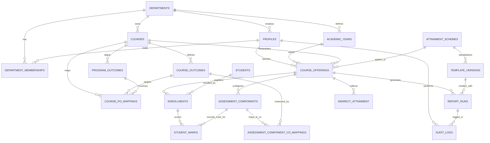

# OutcomeX — Database Schema & Architecture Design

> **Document Status:** Stage 1 Proposed Architecture & ER Diagram  
> **Database:** PostgreSQL (Supabase) with Row Level Security (RLS)  
> **Design Principles:** Strict normalization, UUID primary keys, versioned scheme configs, immutable report runs, and tenant/department authorization.

---

## 1. Entity-Relationship Diagram (Mermaid)

---

## 2. Table Specifications & RLS Strategy

### 2.1 Identity, Department & Multi-Tenancy

#### `departments`
- `id` (UUID, PK, default `gen_random_uuid()`)
- `code` (VARCHAR(20), UNIQUE, e.g. "CSE", "AIDS")
- `name` (VARCHAR(255), e.g. "Computer Science & Engineering")
- `institution_name` (VARCHAR(255), default "Priyadarshini College of Engineering, Nagpur")
- `is_autonomous` (BOOLEAN, default true)
- `created_at` (TIMESTAMPTZ, default `now()`)

#### `profiles`
- `id` (UUID, PK, references `auth.users(id)` ON DELETE CASCADE)
- `full_name` (VARCHAR(255) NOT NULL)
- `email` (VARCHAR(255) UNIQUE NOT NULL)
- `phone` (VARCHAR(50))
- `created_at` (TIMESTAMPTZ, default `now()`)

#### `department_memberships`
- `id` (UUID, PK)
- `profile_id` (UUID, FK `profiles.id`)
- `department_id` (UUID, FK `departments.id`)
- `role` (VARCHAR(50) NOT NULL, CHECK `role IN ('teacher', 'hod', 'department_admin')`)
- `is_active` (BOOLEAN, default true)
- UNIQUE (`profile_id`, `department_id`)

### 2.2 Academic Planning & Courses

#### `academic_years`
- `id` (UUID, PK)
- `department_id` (UUID, FK `departments.id`)
- `year_label` (VARCHAR(50), e.g. "2025-26")
- `is_current` (BOOLEAN, default false)

#### `courses`
- `id` (UUID, PK)
- `department_id` (UUID, FK `departments.id`)
- `course_code` (VARCHAR(50) NOT NULL)
- `course_name` (VARCHAR(255) NOT NULL)
- `semester` (VARCHAR(20) NOT NULL, e.g. "5th Sem")
- `year_of_study` (VARCHAR(20) NOT NULL, e.g. "3rd Yr")
- UNIQUE (`department_id`, `course_code`)

#### `course_offerings`
- `id` (UUID, PK)
- `course_id` (UUID, FK `courses.id`)
- `academic_year_id` (UUID, FK `academic_years.id`)
- `teacher_id` (UUID, FK `profiles.id`)
- `section` (VARCHAR(50), default "A")
- `attainment_scheme_id` (UUID, FK `attainment_schemes.id`)
- `template_version_id` (UUID, FK `template_versions.id`)
- `created_at` (TIMESTAMPTZ, default `now()`)

### 2.3 Outcomes & Curricular Mappings

#### `course_outcomes`
- `id` (UUID, PK)
- `course_id` (UUID, FK `courses.id`)
- `co_code` (VARCHAR(10) NOT NULL, e.g. "CO1", "CO2")
- `description` (TEXT)
- `sort_order` (INT NOT NULL)
- UNIQUE (`course_id`, `co_code`)

#### `program_outcomes`
- `id` (UUID, PK)
- `department_id` (UUID, FK `departments.id`)
- `po_code` (VARCHAR(10) NOT NULL, e.g. "PO1".."PO12", "PSO1".."PSO2")
- `po_type` (VARCHAR(10) NOT NULL, CHECK `po_type IN ('PO', 'PSO')`)
- `description` (TEXT)
- `sort_order` (INT NOT NULL)
- UNIQUE (`department_id`, `po_code`)

#### `course_po_mappings`
- `id` (UUID, PK)
- `course_outcome_id` (UUID, FK `course_outcomes.id`)
- `program_outcome_id` (UUID, FK `program_outcomes.id`)
- `mapping_strength` (INT CHECK `mapping_strength IN (1, 2, 3)` OR NULL)
- UNIQUE (`course_outcome_id`, `program_outcome_id`)

### 2.4 Assessments & Student Marks Model

#### `students`
- `id` (UUID, PK)
- `department_id` (UUID, FK `departments.id`)
- `university_reg_no` (VARCHAR(100) UNIQUE)
- `student_name` (VARCHAR(255) NOT NULL)
- `gender` (VARCHAR(20))

#### `enrollments`
- `id` (UUID, PK)
- `course_offering_id` (UUID, FK `course_offerings.id`)
- `student_id` (UUID, FK `students.id`)
- `roll_no` (VARCHAR(50) NOT NULL)
- `status` (VARCHAR(30) default 'ENROLLED', CHECK `status IN ('ENROLLED', 'DROPPED', 'DETAINED')`)
- UNIQUE (`course_offering_id`, `roll_no`)

#### `assessment_components`
- `id` (UUID, PK)
- `course_offering_id` (UUID, FK `course_offerings.id`)
- `category` (VARCHAR(50) NOT NULL, CHECK `category IN ('MID_TERM_1', 'MID_TERM_2', 'TEACHER_ASSESSMENT', 'END_SEM')`)
- `component_name` (VARCHAR(100) NOT NULL, e.g. "Mid Term-I Q1")
- `max_marks` (NUMERIC(5,2) NOT NULL)
- `sort_order` (INT NOT NULL)

#### `assessment_component_co_mappings`
- `id` (UUID, PK)
- `assessment_component_id` (UUID, FK `assessment_components.id`)
- `course_outcome_id` (UUID, FK `course_outcomes.id`)
- `weight` (NUMERIC(5,2) default 1.0)
- UNIQUE (`assessment_component_id`, `course_outcome_id`)

#### `student_marks`
- `id` (UUID, PK)
- `enrollment_id` (UUID, FK `enrollments.id`)
- `assessment_component_id` (UUID, FK `assessment_components.id`)
- `marks_obtained` (NUMERIC(5,2))
- `status` (VARCHAR(20) default 'PRESENT', CHECK `status IN ('PRESENT', 'ABSENT', 'EXEMPT', 'NOT_ENTERED')`)
- `created_at` (TIMESTAMPTZ, default `now()`)
- `updated_at` (TIMESTAMPTZ, default `now()`)
- UNIQUE (`enrollment_id`, `assessment_component_id`)

#### `indirect_attainment`
- `id` (UUID, PK)
- `course_offering_id` (UUID, FK `course_offerings.id`)
- `course_outcome_id` (UUID, FK `course_outcomes.id`)
- `attainment_level` (NUMERIC(4,2) default 3.0)
- `survey_sample_size` (INT)
- UNIQUE (`course_offering_id`, `course_outcome_id`)

### 2.5 Configurable Schemes & Auditable Reports

#### `attainment_schemes`
- `id` (UUID, PK)
- `department_id` (UUID, FK `departments.id`)
- `scheme_name` (VARCHAR(100) NOT NULL, e.g. "Autonomous 60/40 Scheme", "Autonomous 30/20 Scheme")
- `version` (INT default 1)
- `threshold_percent` (NUMERIC(5,2) default 45.0)
- `level_3_threshold` (NUMERIC(5,2) default 55.0)
- `level_2_threshold` (NUMERIC(5,2) default 45.0)
- `direct_weight` (NUMERIC(5,2) default 0.80)
- `indirect_weight` (NUMERIC(5,2) default 0.20)
- `iam_weight` (NUMERIC(5,2) default 0.40)
- `esam_weight` (NUMERIC(5,2) default 0.60)
- `po_aggregation_method` (VARCHAR(50) default 'WEIGHTED_AVERAGE', CHECK `po_aggregation_method IN ('WEIGHTED_AVERAGE', 'MAPPING_AVERAGE')`)
- `is_approved` (BOOLEAN default true)
- `config_json` (JSONB)

#### `template_versions`
- `id` (UUID, PK)
- `template_name` (VARCHAR(100) NOT NULL, e.g. "60_40_v1", "30_20_v1")
- `file_sha256` (VARCHAR(64) NOT NULL)
- `storage_path` (VARCHAR(500) NOT NULL)
- `sheet_name` (VARCHAR(100) NOT NULL)
- `adapter_identifier` (VARCHAR(100) NOT NULL)
- `is_active` (BOOLEAN default true)

#### `report_runs`
- `id` (UUID, PK)
- `course_offering_id` (UUID, FK `course_offerings.id`)
- `template_version_id` (UUID, FK `template_versions.id`)
- `generated_by` (UUID, FK `profiles.id`)
- `calculation_snapshot` (JSONB NOT NULL)
- `storage_file_path` (VARCHAR(500) NOT NULL)
- `file_checksum` (VARCHAR(64) NOT NULL)
- `validation_warnings` (JSONB)
- `created_at` (TIMESTAMPTZ, default `now()`)

#### `audit_logs`
- `id` (UUID, PK)
- `profile_id` (UUID, FK `profiles.id`)
- `action` (VARCHAR(100) NOT NULL)
- `resource_type` (VARCHAR(100) NOT NULL)
- `resource_id` (VARCHAR(100))
- `payload` (JSONB)
- `created_at` (TIMESTAMPTZ, default `now()`)

---

## 3. Row Level Security (RLS) Policies

1. **Course Offerings:**
   - Teachers can SELECT/UPDATE course offerings where `teacher_id = auth.uid()`.
   - HODs and Admins can view and manage all offerings in their department:
     `department_id IN (SELECT department_id FROM department_memberships WHERE profile_id = auth.uid() AND role IN ('hod', 'department_admin'))`.
2. **Student Marks:**
   - Teachers can only SELECT, INSERT, and UPDATE marks for enrollments belonging to their assigned course offerings.
   - Teachers cannot view or modify student marks from other teachers' courses.
3. **Report Runs & Downloads:**
   - Only the assigned teacher, HOD, or department admin can access private Supabase storage URLs for generated workbooks.
