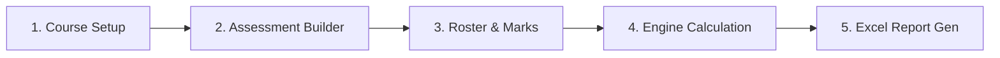

# OutcomeX — User Training & Operations Guide

Welcome to **OutcomeX**, the automated CO-PO-PSO Attainment Automation System for engineering colleges. This guide provides step-by-step instructions for Course Coordinators, Subject Teachers, and Heads of Departments (HODs).

---

## 1. Quick Start Workflow

---

## 2. Step-by-Step Teacher Guide

### Step 1: Course Offering Setup
1. Navigate to `/courses` and click **New Course Offering** or select an existing course (e.g. `25UCS623T - Introduction to Data Science`).
2. Configure the scheme:
   - **Autonomous 60/40 Scheme**: 6 Course Outcomes, 40% IAM (Mid-terms + TA) + 60% ESE.
   - **Autonomous 30/20 Scheme**: 4 Course Outcomes, 40% IAM + 60% ESE.
3. Review or customize the Course Outcome (CO) statements and Bloom's taxonomy levels.
4. Define the CO-to-PO/PSO mapping matrix:
   - Assign mapping strengths: **1** (Low), **2** (Medium), **3** (High), or leave blank for unmapped.
   - Watch the real-time target average update at the bottom of each column.

### Step 2: Assessment Component Builder
1. Configure your assessment components:
   - **Mid-Term Exam 1 (MT1)**: Assess CO1, CO2, CO3 (10 max marks each).
   - **Mid-Term Exam 2 (MT2)**: Assess CO4, CO5, CO6 (10 max marks each).
   - **Teacher Assessment (TA)**: Continuous evaluation (10 max marks).
   - **End Semester Exam (ESE)**: Comprehensive evaluation assessing CO1..CO6.
2. Ensure max marks match college syllabus guidelines.

### Step 3: Student Roster Enrollment
1. Navigate to `/roster`.
2. To enroll students:
   - **Manual entry**: Add individual student roll numbers and names.
   - **Excel Bulk Paste**: Copy roll numbers and names directly from your university spreadsheet (Tab-separated) and paste into the quick-import text area.
3. Verify the enrolled count (e.g. 81 students for CSE 3rd Year).

### Step 4: Marks Entry & Smart Validation
1. Navigate to `/marks`.
2. **Spreadsheet Workspace**:
   - Sticky headers keep Roll Number and Student Name in view while scrolling horizontally.
   - Arrow keys, `Tab`, and `Enter` allow rapid navigation.
   - Values are instantly checked against each component's maximum marks.
   - Absentees are indicated by entering `A` or `ABSENT`. Never enter `0` for absent students!
3. **Excel / CSV Import Wizard**:
   - Click **Import Marks File** to upload an `.xlsx` or `.csv` file.
   - **Step 1: Upload**: Drag & drop your workbook.
   - **Step 2: Sheet & Columns**: Map your Excel columns to MT1, MT2, TA, and ESE components.
   - **Step 3: Validation Review**: The wizard automatically scans for:
     - Out-of-range marks (e.g. score > max marks).
     - Missing roll numbers or unenrolled students.
     - Coercion warnings.
   - **Step 4: Confirm Import**: Safely merge records into your course offering.

### Step 5: Attainment Calculation & Inspection
1. Navigate to `/attainment`.
2. Click **Run Attainment Engine**.
3. Inspect results across the 4 specialized tabs:
   - **Tab 1: CO Attainment Summary**: Displays Direct CO attainment, Indirect CO attainment (course exit survey), and Final CO level.
   - **Tab 2: Component Breakdown**: Detailed breakdown of threshold students, percentage attained, and rubric level (1, 2, or 3) for MT1, MT2, TA, and ESE.
   - **Tab 3: PO & PSO Attainment Matrix**: View achieved PO attainment levels with color-coded badges and comparative target vs. achieved bars.
   - **Tab 4: Formula Audit Inspector**: Click on any CO or PO to view the complete mathematical proof and step-by-step formula breakdown.

### Step 6: Excel Report Generation
1. Navigate to `/reports`.
2. Select the approved college template:
   - **Autonomous 60/40 Scheme**
   - **Autonomous 30/20 Scheme**
3. Click **Generate Accredited Report**.
4. OutcomeX runs the openpyxl template adapter, repairs verified template issues, verifies formulas, and generates the file in `exports/`.
5. Click **Download Report (.xlsx)** to save the report for NBA documentation and departmental filing.

---

## 3. Head of Department (HOD) & Admin Operations

### Viewing Department Attainment Roll-ups
- HODs have global view privileges across all course offerings in the department.
- Access the department dashboard to monitor which courses have completed their marks entry and attainment runs.

### Reviewing Audit Logs
- Navigate to `/api/v1/offerings/[id]/audit` or the system audit screen.
- Review who made edits, when marks were imported, what anomalies were detected, and when attainment reports were generated.
- All log entries are immutable and timestamped in UTC.

---

## 4. Frequently Asked Questions (FAQ)

**Q: Why does an absent student have an 'A' instead of '0'?**
> Entering '0' treats the student as having attempted the exam and scored zero, lowering the denominator or cohort calculation. Entering 'A' preserves the attendance status and ensures college rules on eligible test takers are adhered to strictly.

**Q: Can I change the 45% threshold or 55% level 3 cut-offs?**
> Yes. In the Course Setup screen, under Attainment Scheme Rules, you can adjust the student attainment threshold percentage (default 45%) and the class percentage thresholds for Levels 1, 2, and 3.

**Q: Does generating an Excel report overwrite the college's approved master template?**
> Never. OutcomeX reads the approved template in read-only mode, verifies its SHA-256 checksum, and writes all populated outputs into a new isolated file in the `exports/` directory.
